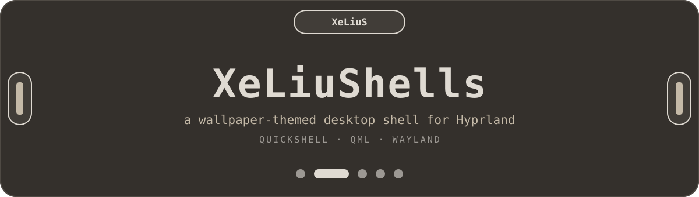
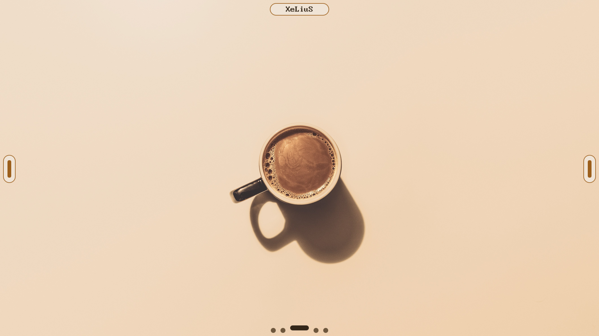
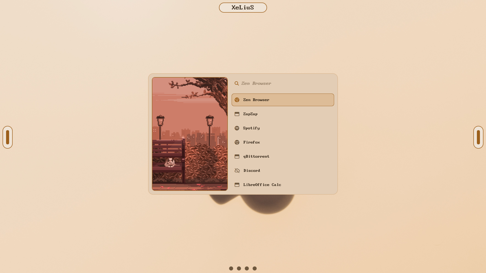
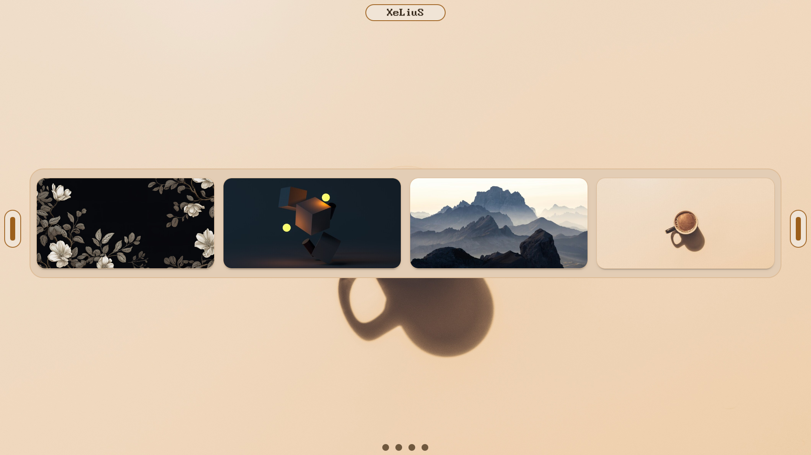
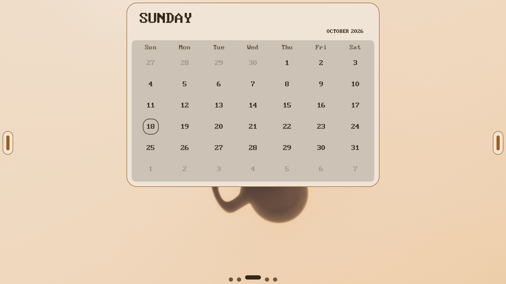
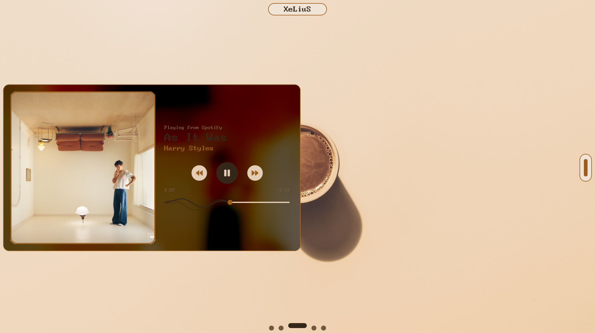
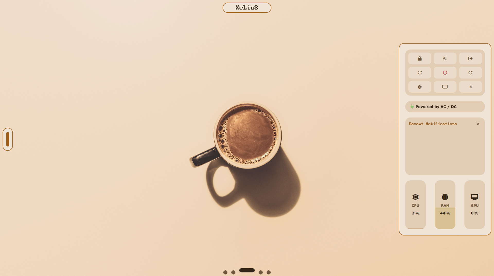
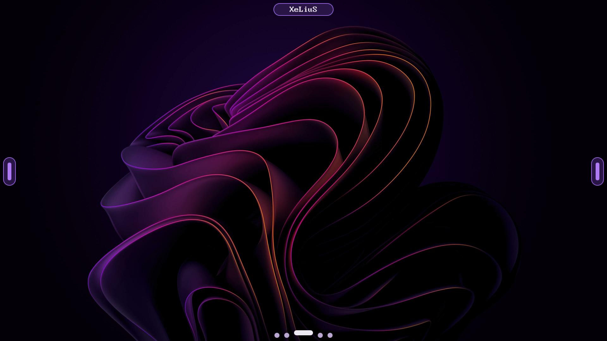

<div align="center">



<br><br>

**Floating pills that grow into a launcher, calendar, media player and control center,<br>and re-color themselves from your wallpaper.**

<br>


</div>

<br>

<p align="center">
  
</p>

<p align="center">
  <a href="#about">About</a> ·
  <!-- <a href="#showcase">Showcase</a> · -->
  <a href="#features">Features</a> ·
  <a href="#gallery">Gallery</a> ·
  <a href="#requirements">Requirements</a> ·
  <a href="#installation">Installation</a> ·
  <a href="#usage">Usage</a> ·
  <a href="#customization">Customization</a> ·
  <a href="#project-structure">Structure</a> ·
  <a href="#credits">Credits</a>
</p>

---

## About

XeLiuShells is a desktop shell for [Hyprland](https://github.com/hyprwm/Hyprland), written in [Quickshell](https://quickshell.org) and QML.

There is no bar. The whole UI is four small pills docked to the screen edges. Each one idles as a tiny handle, reveals quick controls when you hover it, and morphs into a full panel when you click it. Pick a wallpaper and everything (the shell, your Hyprland window borders and the GTK color scheme) re-colors itself to match.

<!--
VIDEO SHOWCASE: hidden until the video is up.

To publish it:
  1. Upload the video to YouTube and copy the video ID (the part after "v=" in the URL).
  2. Replace VIDEO_ID below in the two places it appears.
  3. Delete the first line and the last line of this block (the two comment markers),
     and uncomment the "Showcase" link in the nav at the top of the README.

If the thumbnail doesn't load right after uploading, swap "maxresdefault" for "hqdefault".

## Showcase

[](https://www.youtube.com/watch?v=VIDEO_ID)

**[▶ Watch the full walkthrough on YouTube](https://www.youtube.com/watch?v=VIDEO_ID)**

Covered in the video:

- The workspace dock and how it morphs into the launcher
- Launcher search, command mode and smart launch
- The wallpaper carousel and live re-theming
- The clock pill, running-app view and calendar
- The media pill: sliders and the MPRIS player
- The utility panel: quick toggles, power menu, notifications and meters
-->

## Features

### Four pills, three states each

| Pill | Edge | Idle | Hover | Click |
|---|---|---|---|---|
| **Workspace dock** | Bottom | Five workspace dots; the active one stretches | Dots lift and widen | Click a dot to switch workspace. Click the active dot and it flies to the middle of the screen and becomes the launcher |
| **Clock** | Top | Name of the focused app | Adds the day and time. Scroll to swap in icons of your running apps | Expands into a full month calendar |
| **Media** | Left | Slim handle | Vertical volume and brightness sliders | Expands into an MPRIS media player |
| **Utility** | Right | Slim handle | Six quick toggles | Expands into a power menu, notification feed and system monitors |

Every transition uses overshoot easing, so the pills spring open instead of just resizing.

### Wallpaper-driven theming

Open the wallpaper carousel and pick an image. The shell reacts in one go:

- **60 fps wallpaper transition** through [awww](https://codeberg.org/LGFae/awww), growing outward from the center of the screen.
- **A fresh palette** pulled from the wallpaper itself, with matching dark and light variants. All the theme colors cross-fade over 650 ms.
- **Hyprland borders and the GTK color scheme** follow along, so your windows and GTK apps match the shell.
- **Remembered across restarts.** The palette is cached and restored the next time the shell starts.

<details>
<summary>How the palette is generated</summary>

<br>

`scripts/set_theme.sh` does this with `magick` and a single `awk` pass, with no Python and no extra daemons:

1. Downscale the wallpaper to 64×64.
2. Drop near-black, near-white and near-gray pixels, then sort the rest into 36 hue buckets (10° each), weighting vivid mid-tone pixels higher than dark shadows.
3. Take the strongest bucket, smoothed with its two neighbours, as the theme hue.
4. Build dark and light palettes from that hue in HSL, with deliberate lightness steps between surface, button, hover, accent and text layers.
5. Use the average luminance to decide which polarity to start in. `> toggle theme` flips between the two at any time.
6. Write everything to `~/.cache/quickshell_theme.json`, push the border colors to Hyprland with `hyprctl keyword`, and set `color-scheme` through `gsettings`.

`1.png` is special-cased with a hand-tuned warm palette instead of the generated one.

</details>

### Launcher

The launcher lives inside the workspace dock. It opens as a two-pane card: an animated panel on the left, search and results on the right.

- Searches app names, keywords, categories and generic names from your `.desktop` files.
- Results are ranked by how often you launch them.
- **Smart launch:** if the app is already running, you jump to its workspace instead of opening a second copy.
- Faded ghost-text autocomplete that previews the highlighted result; press <kbd>Tab</kbd> to accept it.
- **Command mode:** start your query with `>` to run shell commands (see [Usage](#usage)).

### Calendar

- Month grid with today ringed.
- Scroll over the month or year label to move through time (±10 years).
- Public holidays get a dot, fetched from the [Nager.Date](https://date.nager.at) API.

### Media player

- Blurred, darkened album art as the backdrop, with the cover on a card that grows slightly while playing.
- Previous / play-pause / next controls.
- An animated wavy seekbar, drawn on a `Canvas`, that you can click or drag to seek.
- Works with any MPRIS player and prefers whichever one is currently playing.

### Utility panel

- **Quick toggles:** Wi-Fi, Bluetooth, Do Not Disturb, mic mute, dark/light and night light.
- **Power menu:** lock, sleep, log out, reboot, shut down, restart shell, hibernate and screen off.
- **Notification feed:** the latest four notifications from Dunst, with a clear button.
- **CPU / RAM / GPU meters:** liquid-fill gauges that only sample while the panel is open.

## Gallery

<table>
  <tr>
    <td width="50%"></td>
    <td width="50%"></td>
  </tr>
  <tr>
    <td align="center"><b>Launcher</b> — morphs out of the workspace dock</td>
    <td align="center"><b>Wallpaper carousel</b> — pick a wallpaper, re-theme everything</td>
  </tr>
  <tr>
    <td width="50%"></td>
    <td width="50%"></td>
  </tr>
  <tr>
    <td align="center"><b>Calendar</b> — with public-holiday markers</td>
    <td align="center"><b>Media player</b> — blurred cover backdrop, wavy seekbar</td>
  </tr>
  <tr>
    <td width="50%"></td>
    <td width="50%"></td>
  </tr>
  <tr>
    <td align="center"><b>Utility panel</b> — power, notifications, system monitors</td>
    <td align="center"><b>Same shell, different wallpapers</b></td>
  </tr>
</table>

## Requirements

Package names vary by distro. Everything below is called from the shell's QML or scripts.

**Core**

| Needs | Used for |
|---|---|
| [Hyprland](https://github.com/hyprwm/Hyprland) | Compositor. Workspaces, window info and `hyprctl` calls |
| [Quickshell](https://quickshell.org) on **Qt 6.5+** | The shell itself. Uses `MultiEffect`, so older Qt 6 won't do |
| PipeWire + WirePlumber (`wpctl`) | Volume, mic state and the PipeWire hooks |
| [awww](https://codeberg.org/LGFae/awww) (with `awww-daemon` running) | Animated wallpaper transitions. Formerly known as `swww` |
| ImageMagick 7 (`magick`) | Wallpaper thumbnails and palette extraction |
| `jq`, `awk`, `bash` | Theme script |
| `gsettings` (GLib) | Syncing the GTK dark/light color scheme |
| `procps-ng` (`vmstat`, `free`) | CPU and RAM meters |

**Per feature**

| Needs | Used for |
|---|---|
| Dunst (`dunstctl`) | Do Not Disturb toggle and the notification feed |
| NetworkManager (`nmcli`) | Wi-Fi toggle |
| BlueZ (`bluetoothctl`) | Bluetooth toggle |
| `brightnessctl` | Brightness slider (the slider dims itself if no backlight is found) |
| `wlsunset` | Night light |
| `hyprlock` | Lock screen button |
| systemd (`systemctl`) | Sleep, reboot, shut down, hibernate |
| `libnotify` (`notify-send`) | Feedback when installing a wallpaper (optional) |
| An MPRIS player (Spotify, Firefox, mpv…) | Media panel |

The UI font, **BigBlueTerm Plus Nerd Font**, is bundled in `assets/fonts/`, so there is nothing to install for icons or text.

## Installation

> [!IMPORTANT]
> The shell calls its own scripts and reads wallpapers by absolute path under `~/.config/quickshell`, so it has to live exactly there.

**1. Clone and install**

```bash
git clone https://github.com/Tahsin404/XeLiuShells.git
cd XeLiuShells

# keep your existing config, if you have one
[ -d ~/.config/quickshell ] && mv ~/.config/quickshell ~/.config/quickshell.bak

cp -r .config/quickshell ~/.config/quickshell
```

**2. Try it**

```bash
qs
```

**3. Autostart and keybinds** (example `hyprland.conf` — pick your own keys)

```ini
exec-once = awww-daemon
exec-once = qs

bind = SUPER, SPACE, exec, qs ipc call dock toggleMenu   # launcher
bind = SUPER, C,     exec, qs ipc call clock toggle      # calendar
bind = SUPER, M,     exec, qs ipc call media toggle      # media player
bind = SUPER, U,     exec, qs ipc call utility toggle    # utility panel
```

**4. Feed notifications to the shell** (optional, for the notification list)

Dunst only writes to the shell's feed if you point it at the bundled script:

```ini
# ~/.config/dunst/dunstrc
[quickshell-feed]
    summary = "*"
    script = ~/.config/quickshell/scripts/on_notify.sh
```

## Usage

**Mouse:** hover a pill to peek, click it to open it, press <kbd>Esc</kbd> to close it again. Clicking outside the launcher closes it too.

**Launcher**

| Input | Action |
|---|---|
| Type | Filter apps |
| <kbd>↑</kbd> / <kbd>↓</kbd> | Move the selection |
| <kbd>Tab</kbd> | Accept the ghost-text completion |
| <kbd>Enter</kbd> | Launch, or jump to the app if it's already running |
| <kbd>Esc</kbd> | Close |

**Command mode** (start with `>`)

| Command | What it does |
|---|---|
| `> wallpaper` | Open the 3D wallpaper and theme carousel |
| `> install wallpaper <path>` | Copy an image into `assets/wallpapers/` and build its thumbnail. With no path, it lists recent images from `~/Downloads` |
| `> toggle theme` | Flip between dark and light |
| `> reload wallpapers` | Rescan wallpapers and rebuild thumbnails |

**Wallpaper carousel**

| Input | Action |
|---|---|
| <kbd>←</kbd> / <kbd>→</kbd> or scroll wheel | Move through wallpapers |
| <kbd>Enter</kbd> or click | Apply the wallpaper and its palette |
| <kbd>Backspace</kbd> | Back to the launcher |
| <kbd>Esc</kbd> | Close |

**Clock pill:** while hovering it, scroll to switch between the day/time view and your running apps. On the calendar, scroll over the month or year label to change it.

## Customization

| I want to… | Edit |
|---|---|
| Change the number of workspace dots | `workspaceCount` in `modules/WorkspaceDock.qml` |
| Change the default colors | The properties at the top of `core/Theme.qml` |
| Change the font | The `FontLoader` source in `core/Theme.qml` |
| Change the corner radii | `radiusPill` and `radiusBlock` in `core/Theme.qml` |
| Show holidays for another country | The `/BD` country code in `fetchEvents()` in `core/Backend.qml` |
| Change the power menu actions | The model in `widgets/utility/PowerAndBattery.qml` |
| Change the quick toggles | `widgets/utility/QuickSettingsGrid.qml` |
| Add wallpapers | Run `> install wallpaper <path>` in the launcher, or drop images into `assets/wallpapers/` and run `> reload wallpapers` |

## Project structure

```text
.config/quickshell/
├── shell.qml                   # entry point: starts the four pills
├── core/                       # singletons and shared logic
│   ├── Theme.qml               #   palette, metrics, font, animated color transitions
│   ├── GlobalState.qml         #   shared reactive state (toggles, meters, clock, models)
│   ├── Backend.qml             #   command runner, sync loop, launcher / wallpaper / theme engine
│   └── FluidBehaviour.qml      #   reusable overshoot-easing Behavior
├── modules/                    # the four pills (one PanelWindow per screen each)
│   ├── WorkspaceDock.qml
│   ├── ClockPill.qml
│   ├── LeftMediaPill.qml
│   └── RightUtilityPill.qml
├── widgets/                    # what lives inside each pill
│   ├── dmenu/                  #   DmenuLayout (launcher), WallpaperCarousel
│   ├── media/                  #   HardwareControls (sliders), MprisPlayer
│   ├── topbar/                 #   CompactClock, ExpandedCalendar
│   └── utility/                #   QuickSettingsGrid, PowerAndBattery, NotificationCenter, HardwareMonitors
├── components/                 # small reusable pieces
│   ├── WorkspaceNode.qml       #   dock dot that morphs into the launcher
│   ├── QuickButton.qml
│   └── HardwareMetric.qml
├── scripts/
│   ├── set_theme.sh            # wallpaper → transition → palette → hyprctl / gsettings sync
│   ├── get_apps.sh             # .desktop scanner, cached to ~/.cache/quickshell_apps.tsv
│   ├── hardware.sh             # CPU / RAM / GPU sampler
│   └── on_notify.sh            # Dunst hook that feeds the notification list
└── assets/                     # fonts, gifs, wallpapers
```

The shell writes a few small files to `~/.cache/`: `quickshell_theme.json`, `quickshell_history.log`, `quickshell_apps.tsv`, `quickshell_notifs.log` and a `quickshell_thumbs/` folder.

<details>
<summary>Notes and known limitations</summary>

<br>

- The battery readout in the utility panel isn't wired to real battery data yet. It currently shows "Powered by AC / DC".
- The GPU meter reads `/sys/class/drm/card0/device/gpu_busy_percent`, which the `amdgpu` driver exposes. On other drivers it shows 0%.
- Holiday dots use Bangladesh's public-holiday list by default (see [Customization](#customization)).
- The Wi-Fi and night-light toggles keep their own state, assuming Wi-Fi on and night light off when the shell starts. Bluetooth, Do Not Disturb, mic and volume are re-read from the system every two seconds.
- The app list is cached after the first run. Delete `~/.cache/quickshell_apps.tsv` to rescan after installing new apps.

</details>

## Credits

- [Quickshell](https://quickshell.org) and [Hyprland](https://github.com/hyprwm/Hyprland), which make a shell like this possible.
- [awww](https://codeberg.org/LGFae/awww) for the wallpaper transitions.
- [Nerd Fonts](https://www.nerdfonts.com) for the bundled BigBlueTerm Plus Nerd Font.
- Caelestia, an inspiration for the look and the animation style.
- Wallpapers and GIFs in `assets/` are demo content. Rights remain with their original creators.

---

<p align="center">
  Made by <a href="https://github.com/Tahsin404">Tahsin</a> (XeLiuS)
</p>

<!-- TODO: add a LICENSE file and a License section here. -->
